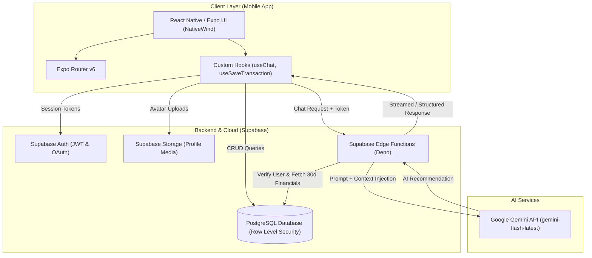

# 📱 PocketBuddy
### *Smart Personal Finance Management & AI-Powered Financial Advisory*

[](https://reactnative.dev/)
[](https://expo.dev/)
[](https://supabase.com/)
[](https://deepmind.google/technologies/gemini/)
[](https://www.typescriptlang.org/)

---

## 📌 Executive Summary

**PocketBuddy** is an intelligent personal finance mobile application developed to bridge the gap between everyday expense tracking and actionable financial literacy. Built with **React Native (Expo)**, **Supabase**, and **Google Gemini AI**, PocketBuddy combines friction-free transaction logging with interactive cash-flow analytics and an integrated, context-aware AI financial coach. 

The platform empowers users to track their spending habits, visualize budget distributions, and receive personalized, data-backed financial guidance tailored to their actual spending history.

---

## 🎯 Objectives

- **Eliminate Logging Friction:** Streamline transaction recording through categorized inputs and an in-app mathematical calculator modal.
- **Provide Actionable Financial Intelligence:** Transform raw financial data into clear visual insights using custom SVG donut charts, monthly cash-flow comparisons, and calendar heatmaps.
- **Democratize Financial Advisory:** Provide users with an on-demand AI financial advisor that analyzes their real-time 30-day transaction history to give contextual, practical budgeting recommendations.
- **Ensure Enterprise-Grade Data Privacy:** Protect sensitive financial records using PostgreSQL Row Level Security (RLS) and encrypted cloud authentication.

---

## 🚀 Key Features

### 1. Frictionless Transaction Tracking
- **Income & Expense Segmentation:** Predefined, intuitive categories with dedicated icon representations (e.g., Food, Transport, Bills, Shopping, Salary, Freelance).
- **Built-In Transaction Calculator:** Perform arithmetic calculations (bill splits, tax additions) directly within the logging interface before saving.
- **Notes & Historical Metadata:** Attach optional contextual notes to transactions for accurate historical lookup.

### 2. Comprehensive Records & Calendar View
- **Dual Presentation Modes:**
  - **List Mode:** Chronologically grouped transactions with multi-criteria search (by note/category) and type filters (All, Income, Expense).
  - **Calendar Mode:** Visual monthly calendar with day-specific transaction markers and instant day-level summary cards.
- **Summary Metrics:** Real-time recalculation of total income, total expenses, and net balance.

### 3. Visual Insights & Cash Flow Analytics
- **Custom Donut Charts:** Category-by-category expense distribution rendered via vector SVGs.
- **Monthly Cash Flow Trends:** Side-by-side comparison of income vs. expenses across historical months.
- **Key Performance Indicators:** Automatic calculation of average daily spending and top expense categories.

### 4. Context-Aware AI Advisor (PocketBuddy AI)
- **Deep Financial Context Injection:** Connected to Google Gemini Flash through Supabase Edge Functions. The assistant analyzes the user's latest 30-day financial summary (net cash flow, category breakdowns, transaction counts) before answering.
- **Practical Guidance:** Delivers concise, encouraging, and actionable budgeting advice formatted in Philippine Peso (₱).
- **Session Continuity & Rate Limiting:** Persistent chat history across sessions with automated daily rate limits to ensure cost efficiency and reliability.

### 5. Secure Authentication & Profile Management
- **Multi-Provider Auth:** Email/password authentication and Google OAuth powered by Supabase Auth.
- **Cloud Media Storage:** Profile avatar uploads and synchronization backed by Supabase Storage.
- **Account Controls:** User bio customization and secure password recovery mechanisms.

---

## 🏗️ System Architecture & Workflow



---

## 🛠️ Technology Stack

| Domain | Technology | Purpose |
|---|---|---|
| **Mobile Framework** | **React Native (v0.81)** / **Expo SDK 54** | Cross-platform mobile development (Android & iOS) |
| **Navigation** | **Expo Router (v6)** | Type-safe, file-based routing and deep-linking |
| **Language** | **TypeScript** | Static typing and codebase reliability |
| **Styling & Design** | **NativeWind (v4 / Tailwind CSS)** | Utility-first styling with responsive scaling (`react-native-size-matters`) |
| **Visualization** | **React Native SVG** & **React Native Calendars** | Custom donut charts, progress bars, and calendar markers |
| **Backend & Database** | **Supabase (PostgreSQL)** | Relational data persistence with strict Row Level Security (RLS) |
| **Authentication** | **Supabase Auth** & **Google Sign-In** | Secure user identity management and session handling |
| **AI Integration** | **Google Gemini Flash API** | Generative AI financial recommendations |
| **Edge Compute** | **Deno / Supabase Edge Functions** | Serverless execution for secure API key isolation and context assembly |

---

## 🌟 Expected Outcomes & Impact

- **Enhanced Financial Literacy:** Transforms passive record-keeping into active financial awareness through visual analytics and AI coaching.
- **Actionable Spending Control:** Helps users pinpoint high-expenditure categories and adjust daily habits before exceeding their means.
- **Scalable Fintech Foundation:** Architectural readiness for future integrations, including Open Banking APIs, automated receipt scanning (OCR), and collaborative household budgeting.

---

## ⚙️ Getting Started (Development Setup)

### Prerequisites
- [Node.js (v18+)](https://nodejs.org/)
- [Expo Go](https://expo.dev/go) app installed on your physical mobile device, or an active Android/iOS simulator.
- A configured [Supabase](https://supabase.com/) project.

### 1. Clone & Install Dependencies
```bash
git clone <repository-url>
cd PocketBuddy
npm install
```

### 2. Configure Environment Variables
Create a `.env` file in the root directory:
```env
EXPO_PUBLIC_SUPABASE_URL=your_supabase_project_url
EXPO_PUBLIC_SUPABASE_ANON_KEY=your_supabase_anon_public_key
```

### 3. Start the Application
```bash
# Start Metro bundler
npm start

# Or launch directly on connected emulator
npm run android   # Android
npm run ios       # iOS
npm run web       # Web Browser
```

---

## 📄 License & Attribution

This project is developed as an academic capstone portfolio project. All rights reserved.
